<p align="center">
  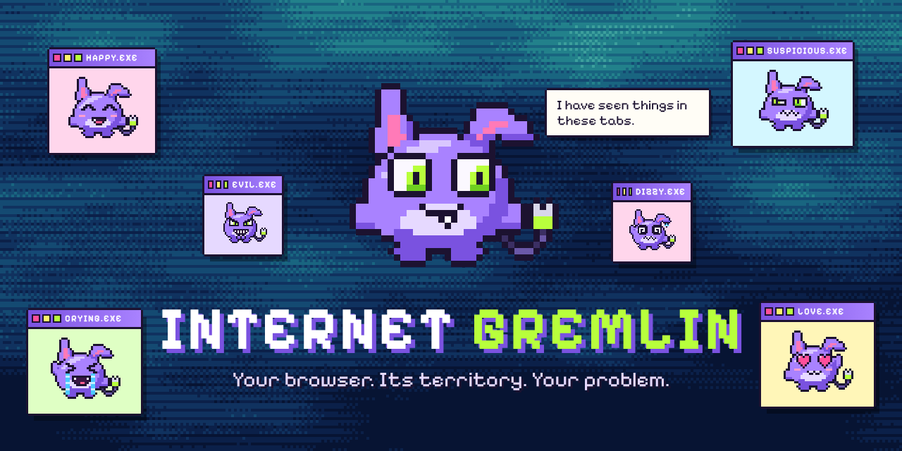
</p>

<h1 align="center">Internet Gremlin</h1>

<p align="center"><strong>Your browser. Its territory. Your problem.</strong></p>

<p align="center">
  <a href="https://github.com/NullkernDev/internet-gremlin/releases/latest"></a>
  <a href="https://github.com/NullkernDev/internet-gremlin/actions/workflows/ci.yml"></a>
  
  
  
  <a href="LICENSE"></a>
</p>

<p align="center">
  A tiny pixel creature that lives on top of your web pages, watches <em>how</em> you browse (never <em>what</em>),<br>
  and reacts with moods, opinions, secrets and a slowly growing relationship. 100% offline. Open source.
</p>

<p align="center">
  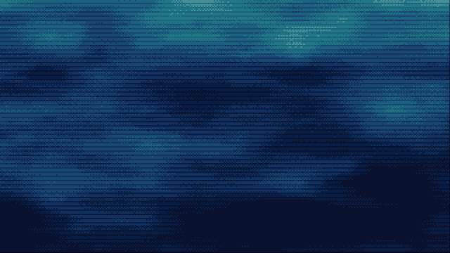
  <br><sub>30-second demo · <a href="promo/demo.mp4">MP4 version with sound 🔊</a> · <a href="#how-the-demo-video-was-made">how it was made</a></sub>
</p>

---

## Contents

- [What it does](#what-it-does)
- [Install it (no coding experience needed)](#install-it-no-coding-experience-needed)
- [How to play with it](#how-to-play-with-it)
- [Screenshots](#screenshots)
- [Privacy](#privacy)
- [Permissions, explained](#permissions-explained)
- [Troubleshooting](#troubleshooting)
- [Development](#development)
- [How it works](#how-it-works)
- [How the demo video was made](#how-the-demo-video-was-made)
- [Known limitations](#known-limitations)
- [Contributing](#contributing)
- [License](#license)

## What it does

Meet **Gorp** (you can rename it). It's a small, slightly ugly-cute purple creature with a tall notched ear, a floppy ear, glowing lime eyes, one snaggletooth and an ethernet cable for a tail. It sits in the corner of every website you visit and has feelings about it.

- **A real personality engine.** A priority-based state machine with 12 moods (Idle, Happy, Bored, Sleeping, Angry, Excited, Jealous, Curious, Shocked, Dramatic, Affectionate, Chaotic), cooldowns and weighted randomness so it feels alive instead of twitchy.
- **15 hand-tuned expressions** (plus dizzy, asleep and *The Stare*), each with its own body animation — bouncing, fuming, sobbing, floating, trembling, spinning.
- **Reacts to how you browse:**
  - clicking around → hops, celebrates, sometimes comments;
  - going idle → looks around, yawns, falls asleep, eventually complains;
  - coming back → wakes up happy, grumpy, aloof — or does a big reunion;
  - lots of tabs → counts them, gets confused, then panics;
  - switching tabs like a maniac → gets dizzy;
  - scrolling → occasionally notices (it won't interrupt you);
  - leaving its tab for a while → gets jealous of “the other tab”.
- **253 original dialogue lines** across 60 situations, plus 28 inner thoughts and 12 “while you were out” notes — organised by mood, event, rarity (common → legendary) and relationship level, with per-line cooldowns so it doesn't repeat itself.
- **A relationship that evolves.** Affection, trust and chaos scores, interaction counts, time together, visits and a favourite activity. A new Gremlin is shy and suspicious; a trusted one is expressive and gets special greetings and tiny dances. Neglect it for days and it gets dramatic — then forgives you after a few nice gestures.
- **17 secret behaviours** to discover (with a collection screen): rare golden eyes, a secret handshake, possum mode, a teleport glitch, a sticky note left while you were away, and more.
- **Mini interactions:** pet it (rub your cursor over it), feed it (cookies, bytes or bugs), play a reaction game, roll a random mood, peek at its current thoughts.
- **Respectful by design:** draggable, compact, minimisable, hideable per site, hides during fullscreen video, never covers clicks outside its own little body, light/dark themes, mute, animation intensity, and a full reduced-motion mode.
- **Short, silly onboarding:** an egg hatches, you name it, learn the controls, pick a personality intensity (Chill / Normal / Unhinged), and read the privacy promise.

<p align="center">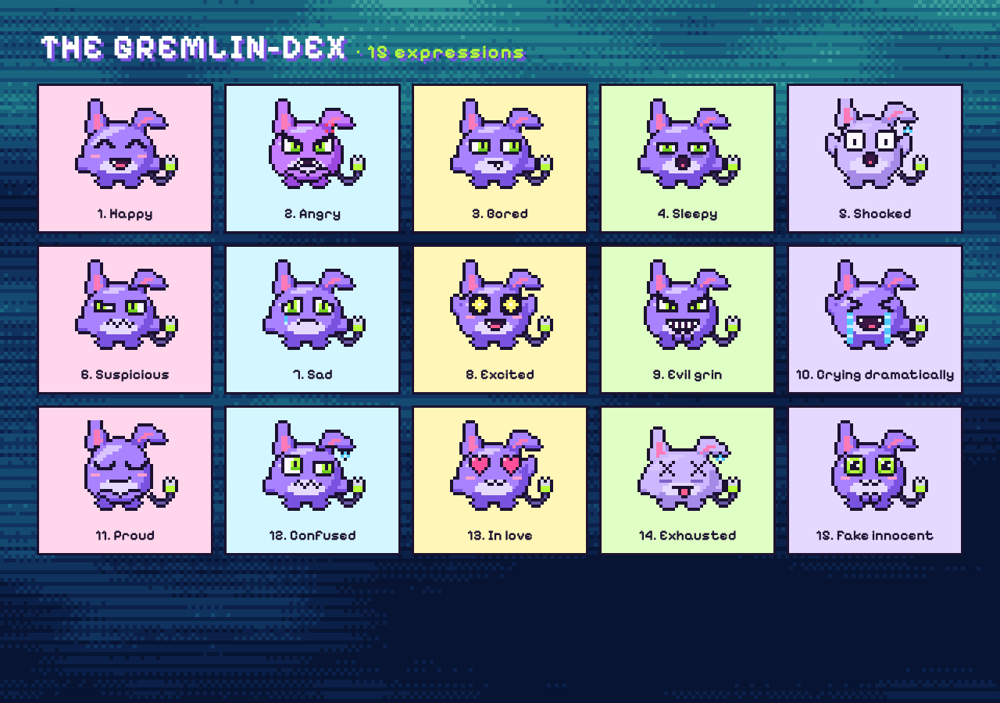</p>

## Install it (no coding experience needed)

Internet Gremlin works in **Google Chrome**, **Microsoft Edge**, **Brave**, **Vivaldi**, **Opera** and other Chromium-based browsers. It is not on an extension store, so you install it “unpacked”. That sounds scarier than it is — it takes about five minutes.

### Option A — you already have a ready-made zip

Download **`internet-gremlin-v1.0.0.zip`** from the [latest release](https://github.com/NullkernDev/internet-gremlin/releases/latest) — no building needed:

1. **Unzip it.** On Windows: right-click → *Extract All…*. On macOS: double-click. You now have a folder, e.g. `Downloads/internet-gremlin-v1.0.0/`. Inside it you should see a file called `manifest.json`.
2. Jump to [Load it into your browser](#load-it-into-your-browser) and pick that folder.

### Option B — build it from this repository

**1. Install Node.js (one time).** Go to [nodejs.org](https://nodejs.org), download the **LTS** version and install it with the default options. Node.js 20.19 or newer is required (22 LTS recommended). To check, open a terminal and run:

```bash
node --version
```

> **What's a terminal?** On Windows, press <kbd>Win</kbd>, type `PowerShell`, press <kbd>Enter</kbd>. On macOS, press <kbd>Cmd</kbd>+<kbd>Space</kbd>, type `Terminal`, press <kbd>Enter</kbd>. On Linux, open your terminal app.

**2. Get the code.** Either:

- **No Git:** on this repository's GitHub page click the green **Code** button → **Download ZIP**, then unzip it. You'll get a folder such as `Downloads/internet-gremlin-main/`.
- **With Git:** run:

  ```bash
  git clone https://github.com/NullkernDev/internet-gremlin.git
  ```

**3. Open a terminal in that folder.** Use `cd` followed by the folder path, for example:

```bash
# Windows (PowerShell)
cd $HOME\Downloads\internet-gremlin-main

# macOS / Linux
cd ~/Downloads/internet-gremlin-main
```

**4. Install dependencies and build.** Run these two commands, one after the other:

```bash
npm install
npm run build
```

`npm install` downloads the build tools (only needed once; takes a minute). `npm run build` creates a folder called **`dist`** inside the project folder and ends with:

```
✔ Internet Gremlin v1.0.0 built into dist/ — load that folder in chrome://extensions
```

### Load it into your browser

1. Open the extensions page by typing this into the address bar and pressing <kbd>Enter</kbd>:
   - Chrome: `chrome://extensions`
   - Edge: `edge://extensions`
   - Brave: `brave://extensions`
2. Turn on **Developer mode** (a toggle in the top-right corner in Chrome/Brave, or in the left sidebar in Edge).
3. Click **Load unpacked**.
4. Select the folder that **contains `manifest.json`**:
   - if you built it: the **`dist`** folder inside the project, e.g. `Downloads/internet-gremlin-main/dist`
   - if you used a zip: the unzipped folder, e.g. `Downloads/internet-gremlin-v1.0.0`
5. A welcome tab opens and an egg starts hatching. 🥚 Follow the short intro.
6. Optional: click the puzzle-piece icon in the toolbar and **pin** Internet Gremlin so its popup is one click away.
7. Visit any normal website. Tabs that were already open need a refresh (<kbd>F5</kbd> / <kbd>Cmd</kbd>+<kbd>R</kbd>) before the Gremlin can move in.

> Chrome may show a “Disable developer mode extensions” reminder when it starts. That is normal for extensions installed this way; just close it.

**Updating later:** download/pull the new code, run `npm install` and `npm run build` again, then click the circular ↻ **reload** button on the Internet Gremlin card in `chrome://extensions`. Your Gremlin's memories are kept.

**Uninstalling:** click **Remove** on its card in `chrome://extensions`. That also deletes everything it stored.

## How to play with it

| Do this | And it… |
| --- | --- |
| **Drag** it | moves anywhere on screen (and remembers the spot on every site). Shake it or drag it in circles and see what happens. |
| **Click** it | gets poked. Reaction depends on its mood and how well it knows you. Don't overdo it. |
| **Rub** your cursor back and forth over it | gets petted. Trust and affection go up. |
| **Right-click** it, or hover and click the **•••** handle | opens its menu: Pet, Feed, Play, Mood dice, Thoughts, Minimize, Hide on this site, Settings. |
| Click the **toolbar icon** | opens the popup: mood, relationship bars, current thought, quick actions, quick toggles. |
| Open **Settings** | personality & animation intensity, reduced motion, theme, size, sound, speech, wandering, hidden sites, the secrets collection, the Gremlin-dex, and your stored data. |

**Minimised**, it hides at the bottom edge with just its ears and eyes peeking out; click to bring it back. **“Summon”** in the popup brings it back to the middle of the page (and un-hides it on that site).

<details>
<summary><strong>Secrets (spoilers!)</strong></summary>

The collection screen in Settings shows hints for locked ones. Some of the 17:

- **The Stare** — very occasionally it looks straight at you, unblinking.
- **Golden Gaze** — a rare golden-eye moment.
- **Possum Mode** — poke it while it's asleep. It may pretend nothing happened.
- **Secret Handshake** — poke, poke, pet, poke.
- **Middle Management** — poke it a *lot*.
- **Blink** — it glitches out and reappears elsewhere.
- **While You Were Out** — after a long break it may leave you a sticky note.
- **Spin Cycle** — drag it around in circles.
- **Tab Tornado** — switch tabs very fast.
- **Witching Hour** — keep it company after midnight.
- …and a few more for you to find.

</details>

## Screenshots

| | |
| --- | --- |
| 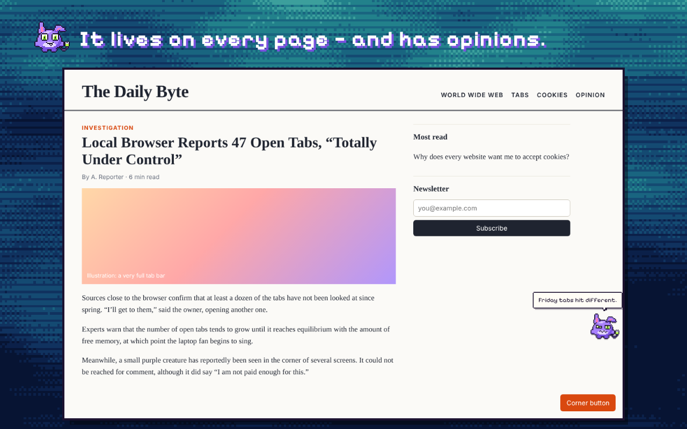 | 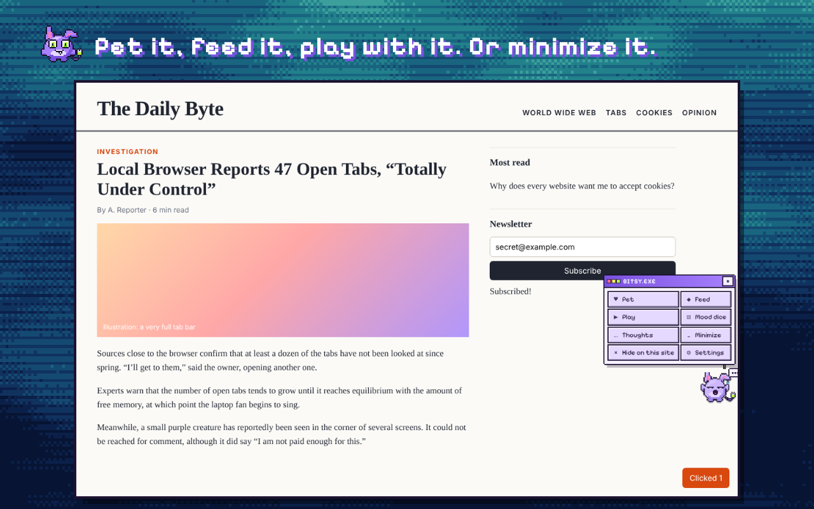 |
| 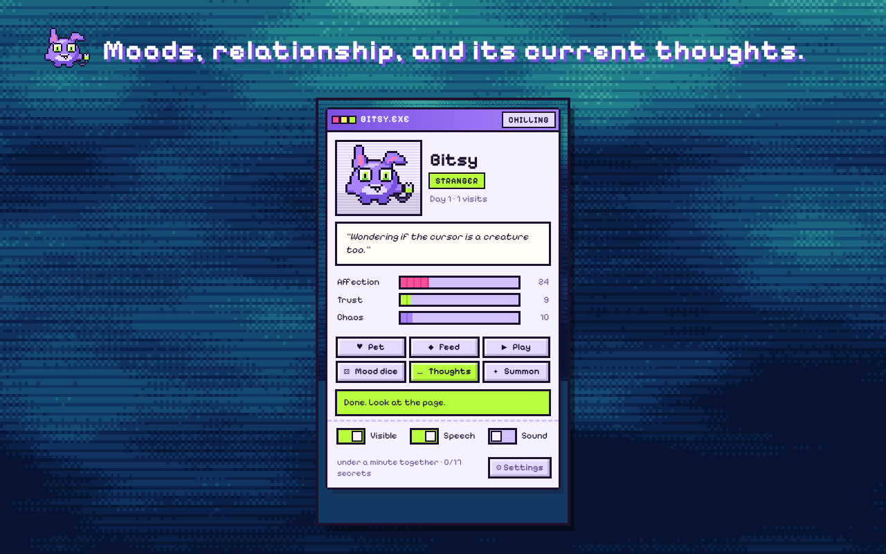 | 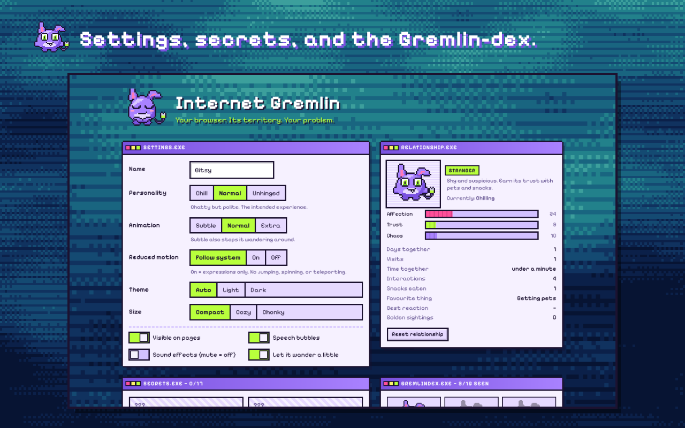 |

Raw captures (taken automatically from the real extension by the end-to-end test) are in [`assets/screenshots/`](assets/screenshots). Reaction stickers are in [`assets/stickers/`](assets/stickers):

<p>
  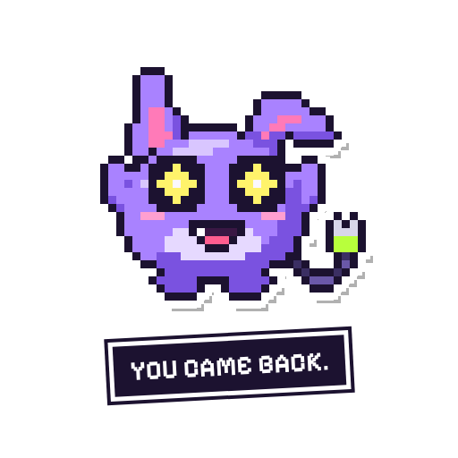
  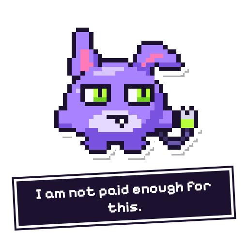
  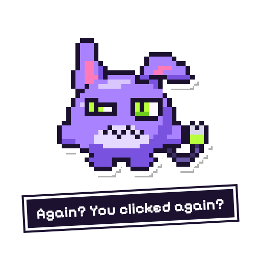
  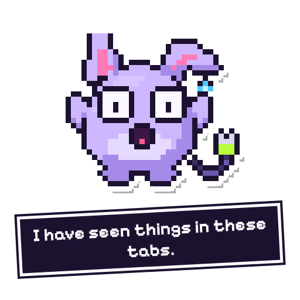
  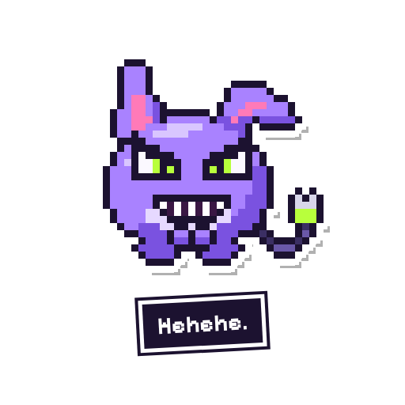
</p>

## Privacy

**Short version: everything stays on your computer.** No servers, no accounts, no analytics, no AI APIs, no tracking. The extension never makes a network request (the end-to-end test checks this).

What it **notices** (only while you're on a page, only as events, never stored as a history):

- *that* the mouse moved, a key was pressed, the page was clicked or scrolled — not *which* key, *what* you clicked, or *where*;
- whether its tab is visible;
- how many tabs are open (a number) and whether you are switching tabs very quickly.

What it **never** reads: page text, form fields, passwords, URLs, page titles, browsing history, cookies.

What it **stores** in `chrome.storage.local` (on your device only): your settings, the Gremlin's position, its relationship numbers and recent mood/thought, the secrets you found, recently used dialogue ids (so it doesn't repeat itself) and the hostnames *you* chose to hide it on. You can view all of it in **Settings → privacy.exe → View my stored data**, and wipe it with **Reset everything**.

Full details: [PRIVACY.md](PRIVACY.md).

## Permissions, explained

When you load it, the browser lists what it can do. Here's what each item means:

| Shown by the browser | Why it's needed |
| --- | --- |
| **“Read and change all your data on all websites”** | This is how the browser describes *any* extension that draws something on top of web pages. Internet Gremlin's content script adds one element (the creature, inside an isolated shadow root) to `http://` and `https://` pages. It does not read or modify the page's content. |
| **Storage** (not shown as a warning) | To remember settings, position and the relationship between visits. |

It does **not** request the `tabs`, `history`, `cookies`, `webRequest`, `scripting` or any host permissions beyond running its content script. Counting tabs uses `chrome.tabs.query`, which without the `tabs` permission returns no URLs or titles.

One honest footnote: the bundled pixel font is a “web-accessible resource” so the Gremlin can use it on pages. Like any extension with web-accessible resources, a website could technically detect that it's installed.

## Troubleshooting

**“Manifest file is missing or unreadable” when loading.** You picked the wrong folder. Select the folder that directly contains `manifest.json` — after building that's the **`dist`** folder, not the project folder.

**`npm` / `node` is not recognised.** Node.js isn't installed or the terminal was opened before installing it. Install the LTS from [nodejs.org](https://nodejs.org), then open a *new* terminal.

**`npm install` fails with an engine or syntax error.** Your Node.js is too old. Run `node --version`; you need 20.19 or newer.

**The Gremlin doesn't appear.**
- Refresh the tab — tabs opened before installing don't have it yet.
- It can't live on browser-internal pages (`chrome://…`, the new-tab page, the Chrome Web Store, built-in PDF viewer). Try a normal site.
- Check it isn't switched off: popup → **Visible**, or Settings → *Hidden on these sites*.
- It hides while a video is fullscreen.
- If it's minimised, look for ears peeking at the bottom edge — or use **Summon** in the popup.

**It's in the way.** Drag it elsewhere, minimise it, pick a smaller size, choose *Hide on this site*, or set Animation to *Subtle* (which also stops it wandering).

**It talks too much / too little.** Settings → Personality: *Chill*, *Normal* or *Unhinged*. Or turn off speech bubbles entirely.

**No sound.** Sound effects are off by default. Turn them on in the popup or Settings. Browsers only allow sound after you've clicked somewhere on the page.

**I changed the code and nothing happened.** Run `npm run build`, click ↻ on its card in `chrome://extensions`, then refresh your tabs.

**Errors on the extensions page after an update.** Click **Clear all** on the errors view, reload the extension, refresh tabs. If it persists, please [open an issue](https://github.com/NullkernDev/internet-gremlin/issues/new/choose).

## Development

Requirements: Node.js 20.19+ and a Chromium-based browser.

```bash
npm install          # install dependencies
npm run build        # production build → dist/
npm run typecheck    # TypeScript, strict mode
npm run lint         # ESLint
npm test             # unit tests for the brain, dialogue, sprites and relationship maths
npm run test:e2e     # builds, loads dist/ into a real Chromium with Playwright, tests it on a website
npm run check        # typecheck + lint + unit tests + build
npm run package      # zips dist/ → release/internet-gremlin-v<version>.zip
npm run dev          # rebuilds the content script on change (reload the extension to see it)
```

Asset & promo pipeline (optional):

```bash
npm run assets       # icons, sky background, expression PNG/SVGs (from the sprite code)
npm run promo        # hero, store art, stickers, framed screenshots (needs Chrome)
npm run demo:build   # builds the browser-based demo page → promo/demo/dist
npm run demo:record  # records promo/demo.mp4 (with soundtrack) + promo/demo.gif (Linux: Xvfb + ffmpeg + Chrome)
npm run demo:sound   # re-synthesises the soundtrack from promo/demo/events.json and muxes it in
```

`npm run test:e2e`, `promo` and `demo:record` need a Chromium-based browser that allows `--load-extension` — Chromium or *Chrome for Testing* (recent branded Chrome builds ignore that flag). Point to it with `CHROME_PATH=/path/to/chrome`.

### Project layout

```
manifest.json            Manifest V3 (version is filled from package.json at build time)
src/
  sprite/                procedural pixel-art renderer: palette, 19 expressions, FX stamps
  engine/
    brain.ts             the state machine: moods, priorities, timers, reactions, secrets
    moods.ts             12 moods → expressions, loop animations, effects
    dialogue.ts          253 lines + thoughts + notes, tagged by event/mood/rarity/tier
    speech.ts            weighted, cooldown-aware line picker
    relationship.ts      affection / trust / chaos, tiers, neglect & forgiveness
    secrets.ts           the 17 secrets
  content/               the in-page Gremlin (React in a shadow root), drag/pet/poke, menus
  background/            service worker: onboarding, tab counting, tab-tornado detection
  popup/ options/ onboarding/   extension pages (React)
  ui/                    shared retro-desktop UI kit
  shared/                types and the storage layer
tests/                   unit tests, Playwright end-to-end test, fixture website
scripts/                 build, packaging, asset generation, promo rendering, demo recording
promo/                   demo video/GIF, store artwork, demo page source
assets/                  mascot, expressions, stickers, hero, screenshots
public/                  icons, bundled font (OFL), sky background
```

## How it works

```
 page events (move/click/scroll/key/visibility)          background service worker
          │  only "something happened" + coordinates            │ tab count, tab-tornado
          ▼                                                     ▼
   content/GremlinApp.tsx ──── events ───▶ engine/brain.ts (state machine)
          ▲                                   │  Snapshot (mood, expression, animation, fx)
          │ render                            │  Outputs (speech, secrets, deltas, moves)
          │                                   ▼
   sprite/sprite.ts (pixel art) ◀──── chrome.storage.local ────▶ popup / options pages
```

- **The sprite** is not a sprite sheet. `src/sprite/sprite.ts` rasterises simple shapes (egg body, ears, limbs, cable tail) onto a 36×32 grid, auto-outlines and shades them, and stamps a face. Eyes track the cursor by moving the iris one pixel. Tears, tail swish and flailing arms are pixel-level frames; bounces, wobbles and spins are CSS. The same code generates the icons, stickers and promo art, so everything stays on-model.
- **The brain** keeps a mood with a priority and minimum duration. Events try to change the mood; higher-priority moods can't be interrupted early. An inactivity ladder runs on a 250 ms tick (only while the tab is visible). Unprompted speech has a global gap that depends on personality intensity; every line also has its own cooldown and the last 40 lines are never reused.
- **Isolation:** the overlay lives in a shadow root, uses `pointer-events: none` everywhere except the creature itself and any open panel, and re-attaches itself if a single-page app wipes the DOM. When the extension is reloaded, old copies clean themselves up.
- **Performance:** passive listeners, `requestAnimationFrame`-throttled pointer handling, no timers while the tab is hidden, memoised SVG rendering, and storage writes batched through a queue. The whole content script is a single ~300 KB file (~95 KB gzipped, React included), loaded from disk — never from the network.

## How the demo video was made

[`promo/demo.mp4`](promo/demo.mp4) (30 s, 1280×720, with sound) and [`promo/demo.gif`](promo/demo.gif) (silent) were produced locally, with no video- or music-generation services:

1. [`promo/demo/`](promo/demo) is a web page that runs **the real in-page Gremlin** — the same `GremlinApp` React component, brain, sprite renderer and CSS as the extension — inside a mock browser window, with an in-memory store instead of `chrome.storage`.
2. A scripted “director” moves a fake cursor and dispatches genuine DOM pointer events (moves, clicks, rubbing over the creature) and the same tab-count messages the background worker would send.
3. [`scripts/record-demo.ts`](scripts/record-demo.ts) opens that page in a real Chrome window on a virtual display (Xvfb), captures it with `ffmpeg -f x11grab` at 30 fps, trims it and encodes the MP4 (H.264) and a palette-optimised GIF.
4. While recording, the demo writes a time-stamped log of every story beat and every reaction of the real engine (jumps, speech, moods, purrs) to [`promo/demo/events.json`](promo/demo/events.json). [`scripts/soundtrack.ts`](scripts/soundtrack.ts) then **synthesises an original chiptune soundtrack and sound effects from code** — square/triangle/noise oscillators, no samples, no third-party music — with a music section per scene (groove, sleepy music-box lullaby, grumpy bassline, panic, love theme, end fanfare) and effects synced to the log: clicks, boings, a yawn, snoring, an alarm, a wail, a purr, and gibberish “voice” blips pitched by mood. Re-mix without re-recording: `npx tsx scripts/soundtrack.ts --mux`.

To keep the story inside 30 seconds and on script, the demo differs from everyday use in three honest ways: the inactivity timers run 24× faster (normally it yawns after a minute and sleeps after two), random ambient behaviour is switched off, and one normally-random choice (how it wakes up) is pinned to the grumpy option. Everything you see it do, it really does. The soundtrack is original and generated by code, so it is free to use with the rest of the project under the MIT licence.

Reproduce with `npm run demo:build && npm run demo:record` on Linux with Xvfb, ffmpeg and Chrome installed.

## Known limitations

- Browsers don't allow extensions on internal pages (`chrome://`, new-tab, extension stores, the PDF viewer), so the Gremlin can't appear there.
- Tabs that were open before installation need a refresh. (Injecting into them automatically would require the extra `scripting` permission and broad host permissions, which we chose not to request.)
- Each tab runs its own copy of the Gremlin; they share memory, settings and position through storage, and only the visible one is active.
- Not packaged for Firefox yet (its Manifest V3 background model differs). Contributions welcome.
- Sound effects can only play after you've interacted with the page (browser autoplay rules).

## Contributing

Ideas, new dialogue lines, secrets, expressions, translations and bug fixes are very welcome. Please read [CONTRIBUTING.md](CONTRIBUTING.md) and the [Code of Conduct](CODE_OF_CONDUCT.md). The quickest way to start: run `npm install && npm run check`, then add a line to `src/engine/dialogue.ts` and see it in action.

## License

[MIT](LICENSE). The bundled *Pixelify Sans* font is licensed under the [SIL Open Font License 1.1](public/fonts/OFL.txt). All character art is original and generated from code in this repository.
